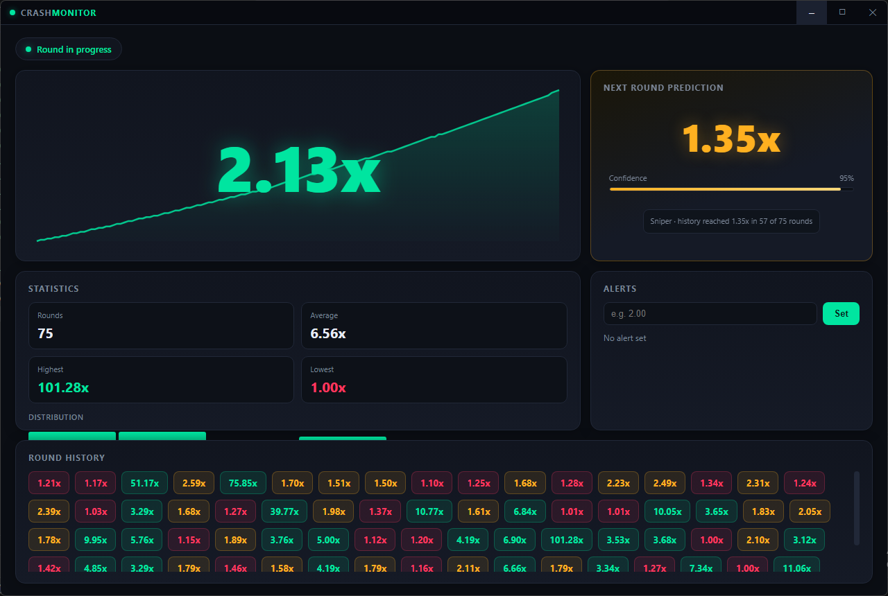
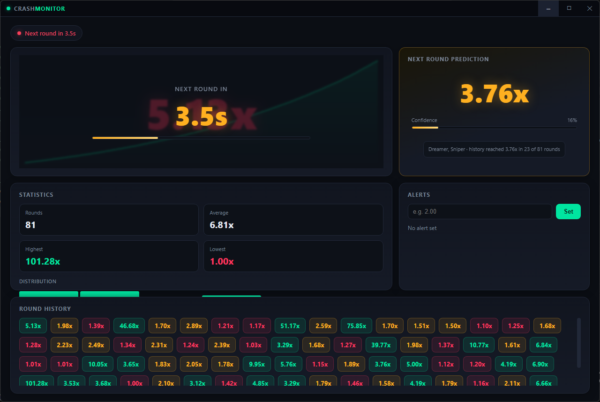

# 🚀 BC Predictor

**A sleek, real-time desktop companion for Crash game players — now with a prediction engine that follows the best bettors.**

BC Predictor (Crash Monitor) is a modern Electron desktop app built to track live multiplier action, surface the next-round outlook, and keep your round history, stats, and alerts right at your fingertips — all wrapped in a slick, glowing dark UI designed for fast-paced crash gameplay.


---

## ✨ Features

### 📈 Live Multiplier Tracker
Watch the multiplier climb in real time with a smooth animated chart and a bold, glowing readout — never lose track of the action mid-round.

### 🔮 Next Round Prediction
A dedicated prediction panel estimates the upcoming round using a **"Follow the Best Bettors" ensemble** — seven virtual bettors with different playing styles replay your round history every round, the profitable ones get followed, and their cash-out targets are blended into one consensus number with an evidence-based confidence meter. (Full breakdown [below](#🧠-prediction-logic--follow-the-best-bettors).)

### ⏳ Round Countdown
A clean countdown overlay bridges the gap between rounds, so you always know exactly when the next round kicks off.

### 📊 Statistics & Distribution
Instantly see your rounds played, average multiplier, highest and lowest hits, plus a live distribution chart breaking down outcomes by range.

### 🕑 Round History
Scroll back through recent rounds with color-coded chips — green for strong multipliers, gold for mid-range, red for early busts. The last 200 rounds feed the prediction engine.

### 🔔 Custom Alerts
Set your own multiplier threshold and get an instant visual + log notification the moment it's reached.

### 🎨 Awesome Dark UI
A custom frameless window, glowing accent colors, animated transitions, and a polished layout make monitoring feel as good as playing.

---

## 🖥️ Preview

Live round in progress — the prediction panel shows the consensus target, the leaders who agree on it, and what history says about it:



Between rounds — countdown overlay while the engine re-forecasts after every crash:



---

## 🧠 Prediction Logic — "Follow the Best Bettors"

Nobody can predict a random crash point. Instead of pretending to, the engine asks a different question:

> *"If I had followed a crowd of virtual bettors with different playing styles over the last rounds — who would be winning right now, and what would they bet next?"*

Every completed round, seven virtual bettors pick a cash-out target from their own personality. Their picks are scored against what actually happened, the winners' opinions are blended into one recommendation, and confidence is measured by two independent pieces of evidence.

### The bettor table

| Bettor | Style | Target behavior |
|---|---|---|
| 🎯 **Sniper** | grinder | Fixed low target — always cashes at **1.35x** |
| ⚖️ **Mid-Liner** | steady | Fixed mid target — always cashes at **2.00x** |
| 💭 **Dreamer** | lotto ticket | Fixed high target — always cashes at **4.50x** |
| 🌊 **Momentum** | mood-driven | Starts at 2.0x; every sub-1.3x bust cuts ambition (−0.6), every 3x+ jackpot raises it (+0.9). Clamped to 1.2–3.5x |
| 🔥 **Streaker** | streak hunter | Counts consecutive early busts (<1.5x). Short streak → patient 1.4x; 2–3 busts → 2.1x; 4+ busts → demands 2.7x |
| 🙃 **Contrarian** | value hunter | Finds which rung of the ladder `[1.35, 1.75, 2.2, 2.7, 3.3]` was hit **least** in the last 10 rounds and camps there — betting it's due |
| 🚀 **Hotshot** | hype chaser | Chases whatever range paid out in the last 3 rounds (clamped to 1.5–3x); nothing hot → grinds at 1.35x |

### Scoring — recent form dominates

Each bettor keeps a **decayed bankroll**. After every round, for a flat 1-unit stake:

- **Hit** (crash ≥ their target): profit = `target − 1 − 0.01 × target` (payout minus house edge)
- **Miss**: loss = `-1`

Then every bankroll decays:

```
score = score × 0.92 + roundProfit
```

The 0.92 decay means each older round carries 8% less weight — roughly the **last 25 rounds decide who leads**, and old glory fades fast. A bettor who went cold loses influence until their numbers recover.

### Blending — profits buy votes

Only bettors **in profit** get a vote (if nobody is, the single top scorer speaks). Each voter's current target is weighted by their bankroll:

```
recommended = Σ(targetᵢ × scoreᵢ) / Σ(scoreᵢ)     (rounded to 2 decimals, min 1.10x)
```

So a rich Sniper quietly pulls the consensus low, while a hot Dreamer can pull it up.

### Confidence — evidence, not vibes

Confidence is the product of two independent signals:

1. **Empirical reach** — how often has history actually reached this target? Shrunk toward the theoretical curve (`0.99 / target`) so small samples can't make wild claims: `p = shrink × empirical + (1 − shrink) × theoretical`, where `shrink = min(1, rounds / 40)`.
2. **Consensus strength** — do the leaders cluster tightly around one number (strong) or scatter across the board (weak)? Tight clusters score near 1.0, scattered opinions drag confidence down.

```
confidence = clamp(5..95, 100 × p × (0.55 + 0.45 × consensus))
```

### Worked scenarios

**Scenario A — slow, low-grinding session** (last rounds full of 1.0x–1.4x busts):

```
Streaker sees 4 busts in a row      →  2.70x
Momentum just took a −0.6 mood hit  →  1.40x
Sniper / MidLiner / Hotshot         →  1.35x–2.00x
Consensus blend                     →  1.35x
Empirical: history hit 1.35x in 57 of 75 rounds (76%)
→  Prediction: 1.35x  ·  Confidence: 95%  ·  "Sniper · history reached 1.35x in 57 of 75 rounds"
```

**Scenario B — session running hot** (recent 5.13x, 46.68x, 75.85x rounds):

```
Momentum rides a jackpot            →  2.90x
Hotshot chases the 5x–46x action    →  3.00x
Dreamer stays fixed                 →  4.50x
Consensus blend (Dreamer leads)     →  3.76x
Empirical: only 23 of 81 rounds reached 3.76x (28%) — leaders disagree
→  Prediction: 3.76x  ·  Confidence: 16%  ·  "Dreamer, Sniper · history reached 3.76x in 23 of 81 rounds"
```

**Cold start:** below 5 rounds of history the engine refuses to guess and shows `warming up…` while it collects data.

The reasoning trail under the confidence bar always shows *who* is leading and *why* — the panel never gives you a bare number without its evidence.

---

## 🛠️ Tech Stack

- **Electron** — cross-platform desktop shell
- **Vanilla JS + Canvas** — lightweight, dependency-free rendering for buttery-smooth charts
- **Custom CSS** — fully hand-crafted dark theme with glow effects and animations

---

## 🚀 Getting Started

### Prerequisites
- [Node.js](https://nodejs.org/) (v18+ recommended)
- npm

### Installation

```bash
npm install
```

### Run the app

```bash
npm start
```

That's it — the app launches straight into live monitoring mode.

### Build the Windows installer

```bash
npm run dist:win
```

The NSIS installer is written to `release/BC-Predictor-Setup-<version>.exe`.

---

## 📁 Project Structure

```
BC_Predictor/
├── src/
│   ├── main.js              # Electron main process & IPC wiring
│   ├── preload.js           # Secure IPC bridge (contextIsolation)
│   ├── crashEngine.js       # Round engine & game loop
│   ├── predictor.js         # "Follow the Best Bettors" prediction engine
│   └── renderer/
│       ├── index.html       # App layout
│       ├── styles.css       # Dark glowing UI theme
│       └── renderer.js      # UI logic & live updates
├── docs/
│   └── images/              # App screenshots
├── electron-builder.yml     # Packaging config
└── package.json
```

---

## ⚙️ Customization

- **Alert threshold** — set any multiplier in the Alerts panel to get notified the moment it's hit.
- **Window controls** — minimize, maximize, and close with the custom titlebar.
- **Theme colors** — tweak `src/renderer/styles.css` to match your own style.
- **Tune the ensemble** — bettor personalities, decay rate (`DECAY = 0.92`) and the minimum history guard all live at the top of `src/predictor.js`.

---

## 📄 License

MIT — use it, modify it, make it your own.

---

<p align="center">Built for crash game enthusiasts who like to watch the numbers climb. 📈</p>
